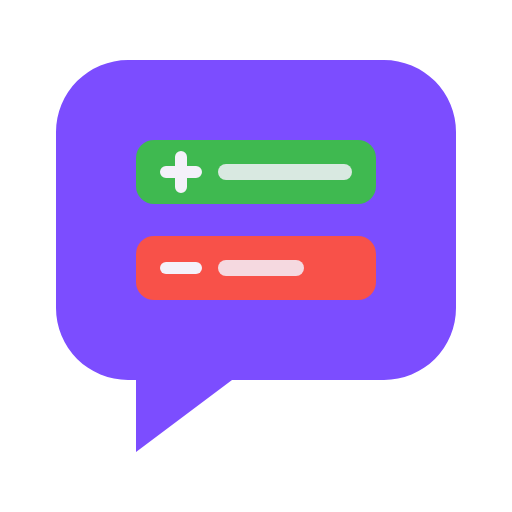

<p align="center">
  
</p>

<h1 align="center">PR Buddy for Claude Code</h1>

<p align="center">
  <strong>Code review on GitHub and GitLab, without leaving Claude Code.</strong><br>
  It reviews, drafts and replies in your voice. Nothing goes out until you say <code>send</code>.
</p>

<p align="center">
  <a href="https://github.com/andret2344/pr-buddy-for-claude-code/actions/workflows/ci.yml"></a>
  
  
  
  <a href="LICENSE"></a>
</p>

<p align="center">
  <a href="plugins/pr-buddy/README.md"><strong>Full documentation</strong></a>
</p>

## What it does

| Command             | What it does                                                                      |
|:--------------------|:----------------------------------------------------------------------------------|
| `/pr-buddy:review`  | Reviews someone else's pull/merge request and posts the review under your name.   |
| `/pr-buddy:respond` | Works through the review threads on your own pull/merge request, then replies.    |
| `/pr-buddy:check`   | Reviews your own branch or pull/merge request locally and posts nothing.          |
| `/pr-buddy:learn`   | Learns your review voice and the rules you keep enforcing from your past reviews. |

## Why pr-buddy

- **You hold the send button.** Nothing is posted until you have seen the full payload and answered with `send`. Each
  post is a single batch: one review, one notification.
- **Your repository stays yours.** pr-buddy never checks out, fetches, pulls, commits or pushes; it hands you those
  commands.
- **Your rules, your voice.** It learns from your past review comments and ships no review rules of its own.

## Install

In a Claude Code session:

```
/plugin marketplace add andret2344/pr-buddy-for-claude-code
/plugin install pr-buddy@andret2344
/pr-buddy:learn
```

Then turn on auto-update once, so new versions reach you without updating by hand: `/plugin` → **Marketplaces** →
**andret2344** → **Enable auto-update**.

Requirements, configuration, updates and the details of every command are in the
[full documentation](plugins/pr-buddy/README.md).

## Repository layout

- `plugins/pr-buddy/`: the plugin itself, the only folder that reaches its users.
- `.claude-plugin/marketplace.json`: the `andret2344` marketplace that lists it.
- Everything else is for developers; see [CONTRIBUTING.md](CONTRIBUTING.md).

## License

[Apache-2.0](LICENSE) © andret2344. Modified versions must keep the [NOTICE](NOTICE) file and mark the files they
change.
